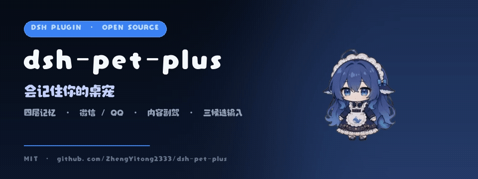
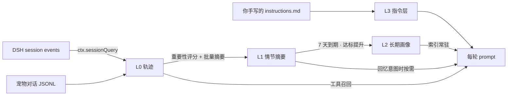
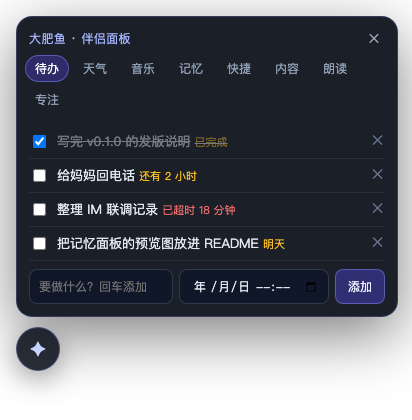
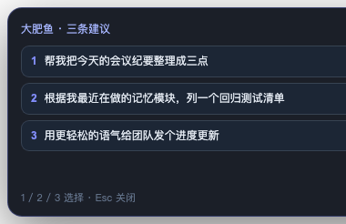
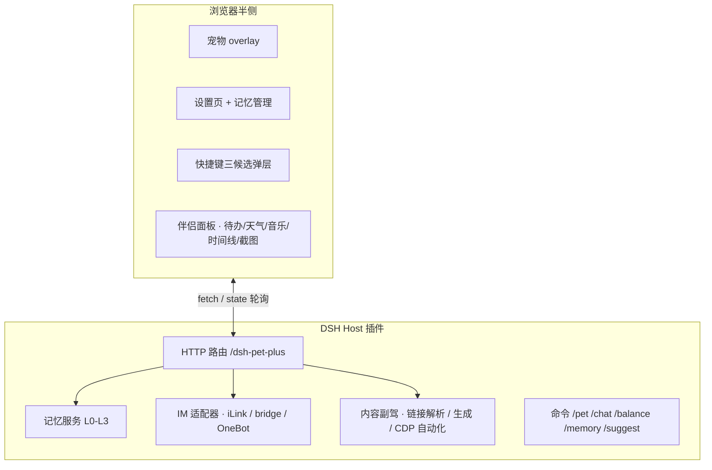

<p align="center">
  
</p>

<h1 align="center">dsh-pet-plus 🐾</h1>

<p align="center">
  <b>会记住你的桌宠</b>：四层长期记忆 · 微信 / QQ 双通道 · 抖音 / 小红书内容副驾 · 快捷键三候选
</p>

<p align="center">
  <a href="LICENSE"></a>
  
  
  
</p>

> ✅ **v0.1.0**：四层记忆、快捷键三候选、微信 / QQ、内容副驾、P1/P2 陪伴功能与伴侣面板已可用；实机平台适配仍按[路线图](#-roadmap)继续打磨。

---

## ✨ 它是什么

`dsh-pet-plus` 是 [dsh-pet](https://github.com/PC2005-cloud/dsh-pet) 的独立增强版：保留那只蓝色大肥鱼的全部桌面陪伴能力（透明动画、拖拽甩抛、多宠物、余额、通知、碎碎念、桌面模式），并补上三件它一直缺的事：

| 缺什么 | dsh-pet-plus 怎么做 |
|---|---|
| **记不住你** | 四层记忆：L3 指令 / L2 长期画像 / L1 情节摘要 / L0 会话轨迹；按需注入，控制 TTFT 与 token |
| **只能等你找它** | 快捷键一键生成 3 条输入候选，直接填进 DSH 输入框；采纳信号回灌画像 |
| **只能在网页里** | 微信（官方 ClawBot）+ QQ（OneBot）双通道；抖音/小红书内容副驾（人工发送） |
| **只能看着** | 伴侣面板：待办倒计时 / 天气 / 正在播放 / 记忆时间线 / 快捷启动 / 朗读 / 截图解释 |

<p align="center">
  
  
</p>

---

## 🧠 记忆：四层，而不是一坨 JSON

```
L3 指令层   你手写的规则/偏好，永远注入，自动提炼永不改
L2 长期记忆 画像/事实/教训；索引常驻，正文按需
L1 情节记忆 重要度门控的会话摘要（可能一天没有，也可能几条）
L0 轨迹     DSH 会话直接复用 ctx.sessionQuery，不复制；宠物对话自建 JSONL
```



| 设计点 | 做法 |
|---|---|
| 不重复存 trace | DSH 会话用 `ctx.sessionQuery` 直接检索；只存宠物自己的对话 |
| 索引常驻、正文按需 | L2 只注入一行一条的索引（≤350 字），细节走 `recall` 工具 |
| 事实会更新 | 新事实取代旧事实（`supersededBy`），旧条归档，不污染上下文 |
| 删除不复活 | 软删 + 7 天回收站 + 90 天墓碑；提炼提示词带墓碑，禁止再加回来 |
| 多端编辑不丢 | `rev` 乐观锁 + 破坏性操作前快照 |
| 成本可控 | 每 8 轮才提炼一次、规则预筛、日预算 30 次 / 40k token |

> 目标：记忆带来的 TTFT 增量 p50 ≤120ms、p95 ≤300ms；常规轮只多一次模型调用。设置页会显示实测的「记忆准备 / 首 token / 三候选」p50 与 p95。

---

## ⌨️ 快捷键三候选

按 `⌘/Ctrl + Alt + K`，宠物根据**你的画像 + 最近输入 + 当前时间**生成 3 条候选，直接填进 DSH 输入框，改完再发。

- 不是“猜你想问”，是“按你平时说话的方式起头”；
- 采纳/丢弃都会作为弱信号回灌画像；
- 10 分钟缓存，失败走零成本模板；
- 桌面模式另注册全局热键 `⌘/Ctrl + Alt + Shift + K`（`DSH_PET_GLOBAL_SHORTCUT` 可改）：不聚焦 DSH 也能生成三条候选，弹出小窗，点击复制到剪贴板。

---

## 💬 微信 / QQ

| 通道 | 方案 | 能力边界 |
|---|---|---|
| 微信 A | 腾讯官方 **ClawBot / iLink** 直连 | 扫码登录；**仅单聊**、一个号一只 Bot、头像不可改（名字可改备注） |
| 微信 B | 通用桥（Wechaty / WeChatAgent / GeWe） | 身份取决于桥账号；支持群聊但默认只回 @；白名单必填 |
| QQ | OneBot v11（NapCat / Lagrange） | 私聊 + 群聊；群聊仅 @ 或前缀；限流/日上限 |

密钥走 DSH credentials，不落明文配置；日志只记元数据，不记正文。

---

## 🎥 内容副驾（抖音 / 小红书）

把链接或截图丢给大肥鱼：

1. 一句话总结 + 3 个要点；
2. 3 条评论/回复候选（真诚 / 幽默 / 专业三种语气）；
3. 引战/风险提示；
4. 一键复制或填进输入框，**由你决定发不发**。

自动化（刷推荐流 + 生成评论 + 发送）作为实验模块提供，**默认关闭**，需勾选风险确认、限额、遇验证码立即停、不碰私信、不绕验证。

---

## 🖱️ 点击音效 / 点击显示余额

- 音效机制对齐桌面版：内置 / 鸭子 / 自定义文件 / 文件夹随机，音量与试听；
- 点击余额：每宠物独立开关，60 秒冷却 + 并发去重，不刷爆服务商接口。

---

## 🧰 陪伴增强（P1 / P2）

| 能力 | 用法 |
|---|---|
| 待办 + 倒计时 | 伴侣面板「待办」；支持截止时间、超时红色提示 |
| 番茄钟 | 面板「专注」：25 / 45 分钟与 5 分钟休息，结束提示音 + 通知 |
| 天气 / 节日 | 「天气」tab；城市在设置里填 |
| 拖拽 / 剪贴板即问 | 把文字拖到页面或复制后按 `⌘/Ctrl+Alt+J` 打开面板，选总结 / 翻译 / 解释 / 写成评论 |
| 截图解释 | 面板上的 📷：截一帧后自动复制并粘进 DSH 输入框，回车即让多模态模型看图 |
| 正在播放 | 「音乐」tab，macOS Music / Spotify，5 秒轮询 |
| 快捷启动 | 设置里配置 App / 网址，面板一键打开（只允许白名单条目，不拼 shell） |
| 朗读 | 「朗读」tab，macOS `say`（默认关） |
| 记忆时间线 | 「记忆」tab，L1 情节 + L2 画像按时间倒序 |
| 点击音效 / 点击余额 | 每只宠物独立开关，60 秒冷却 |

> 伴侣面板快捷键：`⌘/Ctrl + Alt + J`；三候选：`⌘/Ctrl + Alt + K`；桌面全局热键：`⌘/Ctrl + Alt + Shift + K`。

<p align="center">
  
  
</p>

---

## 🚀 快速开始

### 从源码安装（当前推荐）

```bash
git clone git@github.com:ZhengYitong2333/dsh-pet-plus.git
cd dsh-pet-plus
pnpm install
pnpm build

dsh plugin --profile desktop add link:$PWD
```

然后在 `~/.dsh/profiles/desktop/package.json` 的 `dsh.profile.bundles` 里加入 `dsh-pet-plus`，重启 DSH。

> 需要 Node.js ≥ 22.13；首次安装依赖走 `registry.npmmirror.com`（可在 `.npmrc` 改）。

### 配置

- 用户配置：`$DSH_HOME/dsh-pet-plus/main-config.jsonc`
- 记忆与画像：同目录 `memory.json` / `profile.json` / `episodes.jsonl`
- 密钥：全部走 DSH credentials（微信 token、QQ access token 等），**不要写进配置文件**

详细步骤见 [微信 / QQ 接入](docs/setup-im.md) 与 [内容自动化与安全阀](docs/setup-content.md)。

---

## 🏗️ 架构



---

## 🔒 隐私与安全

- **不上传密钥**：仓库 `.gitignore` 排除配置/记忆/浏览器 profile；`scripts/check-secrets.mjs` 在提交前与 CI 扫描 `sk-`、Bearer、私钥、个人路径。
- **本地优先**：记忆与画像只存在本机 `$DSH_HOME/dsh-pet-plus/`；不建云端账号。
- **内容自动化有封号风险**：平台明确治理自动浏览/评论/私信；请用小号，默认关闭，限额、停手、不绕验证码。
- **可审计**：设置页能看今日调用/token、注入内容预览、一键清空。

---

## 🗺️ Roadmap

- [x] P0 基座、构建链、安装冒烟、README、CI
- [x] P1 四层记忆（L0–L3）+ CRUD + 预算/压缩
  - [x] L3 指令层 + 原子存储/跨进程锁 + 每日预算 + 注入渲染 + 单测
  - [x] L0 `ctx.sessionQuery` 适配（cwd 过滤 / 超时降级）
  - [x] L2 条目 CRUD（去重 / 取代 / 墓碑 / 乐观锁 / 容量淘汰）
  - [x] L1 情节摘要（规则门控 / 7 天提升归档 / 索引注入）
  - [x] recall / read_session 工具（最多 1 轮工具调用，预算内）
- [x] P2 输入画像 + 快捷键三候选
  - [x] 输入历史采集（脱敏 / 环形缓冲 / 清空）
  - [x] 快捷键三候选（host 生成 + 会话探针 + 填入输入框 + 模板兜底）
  - [x] 输入画像自动提炼（每 N 条、预算门控、失败静默）
  - [x] TTFT / token 埋点：记忆准备、首 token、三候选 p50/p95（设置页与 `/memory/metrics`）
- [x] P3 微信 iLink / 通用桥 / QQ
  - [x] iLink 扫码/长轮询/发送、通用桥入站、OneBot 入站与发送、白名单/去重/限流
  - [ ] 实机联调（需要真实微信号 / QQ 机器人）
- [x] P4 内容副驾 + 全自动（安全阀）
  - [x] 链接解析 / 总结 + 3 条评论候选 / 10 分钟缓存
  - [x] CDP 自动化骨架（dry-run、限额、静默时段、验证码停手、日志）
  - [x] 设置页启停、日志、风险确认
  - [ ] 平台选择器实机校准
- [x] P5 P1 陪伴增强（拖拽 / 截图 / 待办 / 天气 / 音效 / 余额）
  - [x] 点击音效（default / duck / 音量 / 最小间隔，浏览器 + 桌面 helper）
  - [x] 每宠物「点击显示余额」+ 60s 冷却 + 设置页开关
  - [x] 待办 / 天气 / 节日 / 拖拽即问（host 路由与纯逻辑）
  - [x] 截图：抓帧 → 复制 → 自动粘进 DSH 输入框交给多模态模型
- [x] P6 音乐 / 快捷启动 / TTS / 记忆时间线（伴侣面板）
  - [x] 灵动岛：顶部状态胶囊，待办倒计时 / 工作状态 / 音乐 / 记忆条数
- [x] P7 全局热键（桌面 Helper，候选小窗 + 剪贴板）
- [ ] P7 Live2D/VRM、插件市场、内容平台选择器实机校准

---

## 🤝 Contributing

欢迎 issue / PR。提交前请跑：

```bash
pnpm typecheck
pnpm build
pnpm test
pnpm check:secrets
```

**禁止提交**：任何真实 key、token、`main-config.jsonc`、`memory.json`、`profile.json`、`traces/`、`chrome-profile/`。

---

## 📄 License

- 代码：MIT
- 动画/表情包素材：来自 [dsh-pet](https://github.com/PC2005-cloud/dsh-pet)，**允许开源使用，禁止商用**
- 字体「上首软糖体」：版权归原字体作者，随上游素材原样分发；商用请自行确认授权
- 详见 [NOTICE.md](NOTICE.md)
